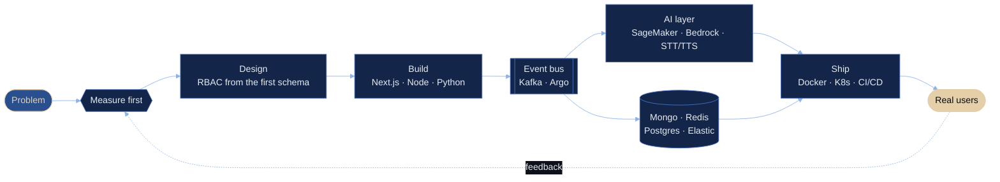

<!-- krish.service — a profile README written as a system spec.
     Midnight & Brass: ink #070A11 · navy #13264A · sapphire #2A4F8F · steel #4A74C4
     ice #8FB3E8 · champagne #E4CFA8 · ivory #E8EBF0 -->


<p align="center">
  <a href="https://krish-portfolio-six.vercel.app">
    
  </a>
</p>

<p align="center">
  <a href="https://krish-portfolio-six.vercel.app"></a>
  <a href="https://www.linkedin.com/in/krish-me/"></a>
  <a href="mailto:krishnendughosal999@gmail.com"></a>
  <a href="https://drive.google.com/file/d/17IshLoqvq43ccBGErfJb_26s0oQ0feUK/view?usp=sharing"></a>
</p>
<p align="center">
  <a href="https://github.com/KriXsh?tab=followers"></a>
  <a href="https://github.com/KriXsh"></a>
  <a href="https://twitter.com/krishxxoo"></a>
  <a href="https://github.com/sponsors/KriXsh"></a>
</p>

<p align="center"><sub><code>RFC-KRISH-001</code> &nbsp;·&nbsp; Status: <b>Production</b> &nbsp;·&nbsp; Region: India → worldwide &nbsp;·&nbsp; Open to: new projects &amp; remote roles</sub></p>

<p align="center"><sub>
<a href="#-01--whoami">01 whoami</a> ·
<a href="#-02--architecture">02 architecture</a> ·
<a href="#-03--changelog">03 changelog</a> ·
<a href="#-04--deployments">04 deployments</a> ·
<a href="#-05--dependencies">05 dependencies</a> ·
<a href="#-06--telemetry">06 telemetry</a> ·
<a href="#-07--signed-artifacts">07 signed artifacts</a> ·
<a href="#-08--open-ports">08 open ports</a>
</sub></p>

---

## ✦ 01 · whoami

<table>
<tr>
<td width="28%" align="center" valign="top">
  <br/>
  <sub><code>GET /api/v1/krish</code><br/><b>200 OK</b></sub>
</td>
<td width="72%" valign="top">

```jsonc
{
  "name": "Krishnendu Ghosal",
  "role": ["Full-Stack Developer", "AI/ML Engineer", "Cloud & DevOps"],
  "current": {
    "org": "Ironbook AI",
    "shipping": ["speech-to-text & voice services", "customer data platforms",
                 "Kafka-driven pipelines on Kubernetes"]
  },
  "experience": { "years": "3+", "companies": 5,
                  "domains": ["Gov-Tech", "Fintech", "B2B Enterprise", "B2C Digital"] },
  "learning":  ["LLM agents", "RAG", "MLOps", "large-scale system design"],
  "ask_me_about": ["Next.js", "Node.js", "Python", "Kafka", "Kubernetes",
                   "SageMaker", "Bedrock", "Redis", "MongoDB", "Elasticsearch"]
}
```

</td>
</tr>
</table>

> **Design principle.** Code is poetry, systems are symphonies, and great software is the intersection of engineering excellence and user delight.

---

## ✦ 02 · architecture

How a problem moves through me, drawn the way I'd draw any other system.



| <sub>SLO</sub> | <sub>Principle</sub> | <sub>Reference</sub> |
|:-:|:--|:--|
| <sub>`p0`</sub> | <sub>**Production over demos**: AI that ships and holds up under real users</sub> | <sub>[Case study: Voice AI, speech in, speech out](https://krish-portfolio-six.vercel.app/case-studies/ironbook-voice-ai)</sub> |
| <sub>`p1`</sub> | <sub>**Measure, then optimise**: numbers before opinions</sub> | <sub>[Case study: a secure, fast API platform for fintech](https://krish-portfolio-six.vercel.app/case-studies/invincible-ocean-api-platform)</sub> |
| <sub>`p2`</sub> | <sub>**Security is architecture**: access control from the first schema</sub> | <sub>[Blog: RBAC done right](https://krish-portfolio-six.vercel.app/blog/rbac-done-right)</sub> |
| <sub>`p3`</sub> | <sub>**Automate the path to prod**: releases should be boring</sub> | <sub>[Blog: Zero-downtime deploys](https://krish-portfolio-six.vercel.app/blog/zero-downtime-deploys)</sub> |

---

## ✦ 03 · changelog

```diff
$ git log --oneline --graph career

* (HEAD -> ironbook-ai) feat(ai): manage agent lifecycles on AWS SageMaker & Bedrock
*   feat(voice): ship speech-to-text and voice features end to end
*   feat(pipeline): event-driven async systems on Kafka
*   feat(migration): large-scale data migrations with Argo Workflows on Kubernetes
|
* feat(gov-tech): media monitoring for 60 Government of India ministries
*   + crawlers across 200+ newspapers, YouTube and X
*   + STT / TTS APIs and prompt-engineered AI layer
|
* feat(security): RBAC with JWT and AWS IAM across frontend, backend, infra
|
* perf(api): architect 350+ APIs
+   MongoDB response time  -40%
+   downtime               -40%
+   server performance     +25%
|
* ci(devops): Docker · Kubernetes · Jenkins / GitLab CI
+   deployment time        -40%
+   delivery speed      +40–50%
|
* init: B.Tech CSE, Lovely Professional University (2019 – 2023)
```

---

## ✦ 04 · deployments

| <sub>Service</sub> | <sub>What it does</sub> | <sub>Stack</sub> | <sub>Status</sub> |
|:--|:--|:--|:-:|
| <sub>[**StockX AI Portal**](https://stock-x-ai.vercel.app)</sub> | <sub>Live pricing, AI market recaps and sentiment-tagged news</sub> | <sub>Next.js · AI recaps · live market data</sub> | <sub>🟢 live</sub> |
| <sub>[**LMS Portal**](https://lms-ed-teach-eight.vercel.app)</sub> | <sub>Production-level EdTech platform for courses and learners</sub> | <sub>Next.js 15 · TypeScript · MongoDB</sub> | <sub>🟢 live</sub> |
| <sub>[**Pathfinding Visualizer**](https://pathfinding-visualizer-theta-puce.vercel.app/)</sub> | <sub>Dijkstra, A\*, BFS and DFS on a live, editable grid</sub> | <sub>Next.js · TypeScript · Framer Motion</sub> | <sub>🟢 live</sub> |
| <sub>[**SortFusion**](https://sort-fusion-ui.vercel.app)</sub> | <sub>Every compare and swap of eight sorting algorithms, visualized</sub> | <sub>Next.js · TypeScript · Framer Motion</sub> | <sub>🟢 live</sub> |

<p align="center"><a href="https://krish-portfolio-six.vercel.app/projects"></a></p>

---

## ✦ 05 · dependencies

<details open>
<summary><code>package.lock</code> &nbsp;—&nbsp; resolved tree</summary>
<br/>

**`web`**
<p align="left"></p>

**`ai / ml`**
<p align="left">
  
  <br/>
  
  
  
  
  
</p>

**`cloud / devops`**
<p align="left"></p>

**`data`**
<p align="left"></p>

**`languages / tools`**
<p align="left"></p>

</details>

---

## ✦ 06 · telemetry

<p align="center">
  
  
  
</p>

---

## ✦ 07 · signed artifacts

<table align="center">
<tr>
<td align="center" width="50%">
  <br/><br/>
  <a href="https://drive.google.com/file/d/1Dqg8pcfCLSiwoBrOsk82gu8Op_jLdvJS/view"><b>Claude Certified Developer – Foundations</b></a><br/>
  <sub><code>sig: verified · Credly</code></sub>
</td>
<td align="center" width="50%">
  <br/><br/>
  <a href="https://www.credly.com/badges/cd067e9d-a3b6-4224-a063-086cdfdcc67b/public_url"><b>Claude Certified Associate – Foundations</b></a><br/>
  <sub><code>sig: verified · Credly</code></sub>
</td>
</tr>
</table>

<details>
<summary><b>More artifacts</b> &nbsp;<sub>(8)</sub></summary>
<br/>

| | <sub>Certification</sub> | <sub>Issuer</sub> |
|:-:|:--|:--|
| <sub>🥇</sub> | <sub>Jumpstart – Publicis Sapient Competitive Coding Event</sub> | <sub>Publicis Sapient</sub> |
| <sub>🌐</sub> | <sub>ACE Multicloud Network Associate</sub> | <sub>Aviatrix</sub> |
| <sub>☕</sub> | <sub>[Java Foundations Certification](https://www.hackerrank.com/certificates/a9ef7324ba06)</sub> | <sub>HackerRank</sub> |
| <sub>⚛️</sub> | <sub>React Redux Training</sub> | <sub>Cipher Schools</sub> |
| <sub>🤖</sub> | <sub>Artificial Intelligence Fundamentals</sub> | <sub>Invincible Ocean</sub> |
| <sub>🛡️</sub> | <sub>Website Hacking / Penetration Testing</sub> | <sub>Udemy</sub> |
| <sub>💻</sub> | <sub>Web Development Bootcamp</sub> | <sub>Udemy</sub> |
| <sub>🐍</sub> | <sub>Object-Oriented Programming Using Python</sub> | <sub>E-Box</sub> |

</details>

---

## ✦ 08 · open ports

```console
$ netstat -krish --listening
PORT    SERVICE        STATUS
443     portfolio      LISTEN   → krish-portfolio-six.vercel.app
587     email          LISTEN   → krishnendughosal999@gmail.com
8080    linkedin       LISTEN   → in/krish-me
9000    collaboration  LISTEN   → new projects · remote roles
```

<p align="center">
  <a href="https://krish-portfolio-six.vercel.app"></a>
  <a href="https://www.linkedin.com/in/krish-me/"></a>
  <a href="https://twitter.com/krishxxoo"></a>
  <a href="https://instagram.com/krishxxoo"></a>
  <a href="https://leetcode.com/u/KriXsh999/"></a>
  <a href="https://www.hackerrank.com/profile/krishnendughosa1"></a>
  <a href="https://www.codechef.com/users/krishnendu_99"></a>
  <a href="mailto:krishnendughosal999@gmail.com"></a>
</p>

<p align="center"><sub><code>$ systemctl status krish.service</code> &nbsp;→&nbsp; <b>● active (running)</b> &nbsp;·&nbsp; thanks for visiting ✦</sub></p>


