<!-- Midnight & Brass theme: matches krish-portfolio-six.vercel.app
     ink #070A11 · surface #0B1019 · navy #13264A · sapphire #2A4F8F
     steel #4A74C4 · ice #8FB3E8 · champagne #E4CFA8 · ivory #E8EBF0
     Skill cards + buttons are self-hosted in ./assets (no external badge service). -->.  

  

  
  
  
  

  
  
  
  

 

✦ &nbsp; I N T R O D U C T I O N &nbsp; ✦

<h2 align="center">Engineer by craft, builder by instinct.</h2>

<table align="center">
<tr>
<td align="center" width="32%">
    
  <b>Krishnendu Ghosal</b> 
  <i>Based in India · Working worldwide</i>
</td>
<td width="68%">

I'm a software engineer who architects **AI-powered platforms**, **event-driven data pipelines** and **cloud infrastructure** built to scale. From government-tech infrastructure to fintech platforms, I've delivered across diverse domains, driven by the thrill of solving complex problems, optimizing performance and building technology that genuinely improves people's lives.

- ✦ **Now:** Full-stack Developer & AI/ML Engineer at **Ironbook AI**: speech-to-text & voice services, customer data platforms and Kafka-driven pipelines on Kubernetes
- ✦ **Track record:** 3+ years · 5 companies · 4+ domains (B2G / Gov-Tech, FinOps / Fintech, B2B Enterprise, B2C Digital)
- ✦ **Learning:** LLM agents, RAG architectures, MLOps and large-scale system design
- ✦ **Ask me about:** Next.js, Node.js, Python, Kafka, Kubernetes, AWS (SageMaker, Bedrock), Redis, MongoDB, Elasticsearch

> *"Code is poetry, systems are symphonies, and great software is the intersection of engineering excellence and user delight."*

</td>
</tr>
</table>

<b>H O W &nbsp; I &nbsp; W O R K</b>

| | Principle | Read more |
|:-:|:--|:--|
| 🚀 | **Production over demos**: AI that ships and holds up under real users | [Case study: Voice AI, speech in, speech out](https://krish-portfolio-six.vercel.app/case-studies/ironbook-voice-ai) |
| 📈 | **Measure, then optimise**: numbers before opinions | [Case study: a secure, fast API platform for fintech](https://krish-portfolio-six.vercel.app/case-studies/invincible-ocean-api-platform) |
| 🛡️ | **Security is architecture**: access control from the first schema | [Blog: RBAC done right](https://krish-portfolio-six.vercel.app/blog/rbac-done-right) |
| ⚙️ | **Automate the path to prod**: releases should be boring | [Blog: Zero-downtime deploys](https://krish-portfolio-six.vercel.app/blog/zero-downtime-deploys) |

✦ &nbsp; E X P E R I E N C E &nbsp; ✦

<h2 align="center">Where I've built things.</h2>

| | |
|:-:|:--|
| 🤖 | Managed AI agent lifecycles on **AWS SageMaker & Bedrock** and shipped STT and voice features end to end |
| ⚡ | Built event-driven async systems on **Kafka** and large-scale data migrations with **Argo Workflows on Kubernetes** |
| 🛰️ | Built the crawlers, pipelines and AI layer of a **media-monitoring platform for 60 Government of India ministries**: **200+ newspapers**, YouTube and X, with speech-to-text / text-to-speech APIs and prompt engineering |
| 🔐 | Designed secure **RBAC** with JWT and AWS IAM across frontend, backend and infrastructure |
| 🚀 | Architected **350+ APIs**, cut MongoDB response times by **40%**, reduced downtime by **40%** and improved server performance by **25%** |
| ☁️ | Reduced deployment time by **40%** and sped up delivery by **40–50%** with Docker, Kubernetes and Jenkins / GitLab CI |

✦ &nbsp; S E L E C T E D &nbsp; W O R K &nbsp; ✦

<h2 align="center">Featured projects.</h2>

<table align="center">
<tr>
<td align="center" width="50%">
  01 
  <a href="https://stock-x-ai.vercel.app"><b>StockX AI Portal</b></a>  
  Live pricing, AI market recaps and sentiment-tagged news 
  <i>Next.js · AI Recaps · Live Market Data</i>
</td>
<td align="center" width="50%">
  02 
  <a href="https://lms-ed-teach-eight.vercel.app"><b>LMS Portal</b></a>  
  Production-level EdTech platform for courses and learners 
  <i>Next.js 15 · TypeScript · MongoDB</i>
</td>
</tr>
<tr>
<td align="center" width="50%">
  03 
  <a href="https://pathfinding-visualizer-theta-puce.vercel.app/"><b>Pathfinding Visualizer</b></a>  
  Dijkstra, A*, BFS and DFS on a live, editable grid 
  <i>Next.js · TypeScript · Framer Motion</i>
</td>
<td align="center" width="50%">
  04 
  <a href="https://sort-fusion-ui.vercel.app"><b>SortFusion</b></a>  
  Every compare and swap of eight sorting algorithms, visualized 
  <i>Next.js · TypeScript · Framer Motion</i>
</td>
</tr>
</table>

✦ &nbsp; T E C H N I C A L &nbsp; A R S E N A L &nbsp; ✦

<h2 align="center">The stack I ship with.</h2>

✦ &nbsp; S T A T I S T I C S &nbsp; ✦

<h2 align="center">By the numbers.</h2>

  
  

<i>Stats refresh automatically every 6 hours via GitHub Actions.</i>

✦ &nbsp; C R E D E N T I A L S &nbsp; ✦

<h2 align="center">Certifications & achievements.</h2>

<table align="center">
<tr>
<td align="center" width="50%">
    
  <a href="https://drive.google.com/file/d/1Dqg8pcfCLSiwoBrOsk82gu8Op_jLdvJS/view"><b>Claude Certified Developer – Foundations</b></a> 
  <i>Credly verified</i>
</td>
<td align="center" width="50%">
    
  <a href="https://www.credly.com/badges/cd067e9d-a3b6-4224-a063-086cdfdcc67b/public_url"><b>Claude Certified Associate – Foundations</b></a> 
  <i>Credly verified</i>
</td>
</tr>
</table>

| | Certification | Issuer |
|:-:|:--|:--|
| 🥇 | Jumpstart – Publicis Sapient Competitive Coding Event | Publicis Sapient |
| 🌐 | ACE Multicloud Network Associate | Aviatrix |
| ☕ | [Java Foundations Certification](https://www.hackerrank.com/certificates/a9ef7324ba06) | HackerRank |
| ⚛️ | React Redux Training | Cipher Schools |
| 🤖 | Artificial Intelligence Fundamentals | Invincible Ocean |
| 🛡️ | Website Hacking / Penetration Testing | Udemy |
| 💻 | Web Development Bootcamp | Udemy |
| 🐍 | Object-Oriented Programming Using Python | E-Box |

✦ &nbsp; E D U C A T I O N &nbsp; ✦

<b>Lovely Professional University</b> <i>B.Tech in Computer Science & Engineering</i> 2019 – 2023 · CGPA 7.0 / 10

✦ &nbsp; C O N T A C T &nbsp; ✦

<h2 align="center">LET'S CREATE SOMETHING Amazing</h2>

<i>Currently open for new projects and remote roles.</i>

  
  
  
  
  
  
  
  

T H A N K &nbsp; Y O U &nbsp; F O R &nbsp; V I S I T I N G &nbsp; ✦

